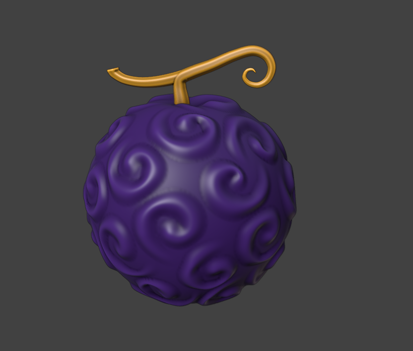

> Note: This is from leaked data!
This can be removed or changed later!
{: .prompt-danger }

{: width="486" height="294" .w-50 .right}
Rubber fruit is a comfirmed [fruit](https://monkey-piece.github.io/posts/Fruits) that is comming to [Monkey Piece](https://monkey-piece.github.io/about).
The model of this [fruit](https://monkey-piece.github.io/posts/Fruits) on the image is currently out-dated but the new model has not bee leaked yet.
From what we currently know the ability name can be place holders and will later get there true names.
Next to [Flame](https://monkey-piece.github.io/posts/Flame-Fruit/) this is currently the only other 100% comfirmed fruit that will be in [Monkey Piece](https://monkey-piece.github.io/about).

- Current Rubber leaks:

